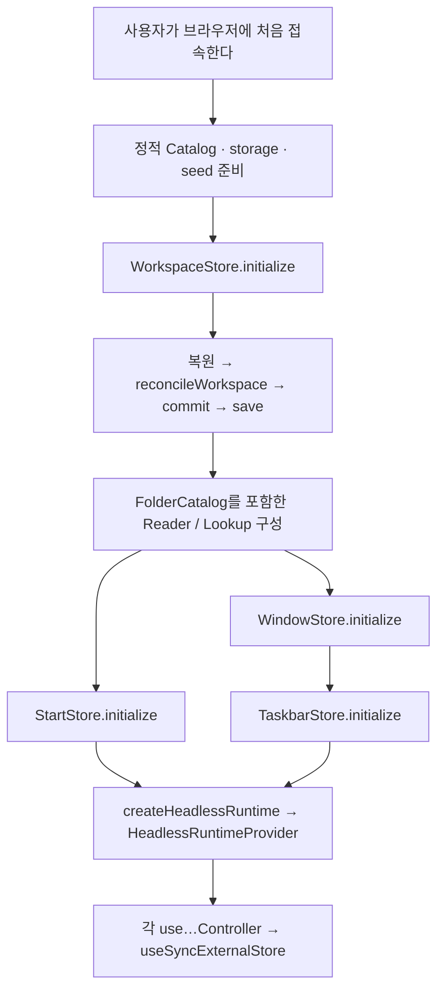

# Headless 실행 플로우

사용자의 행동이 어떤 파일과 함수를 거쳐 상태 변경, 화면 갱신, 저장으로 이어지는지 따라가는 코드 안내다. 용어 자체의 뜻은 [개발 용어집](./용어집.md)을 참고한다. 설계와 계약의 정본은 Workbench Local Work Memory의 `seojaewan/seojaewan-blog` 프로젝트에서 관리한다.

이 문서는 `8a68185`의 Headless 구현을 기준으로 작성했다. **현재 제품 UI의 클릭 핸들러와 브라우저 초기화 호출부는 아직 연결되어 있지 않다.** 각 흐름은 사용자 행동이나 화면에서 일어나는 상황을 말로 설명한 뒤, 그 상황에 대응하는 현재 Headless 함수로 이어진다. Headless가 직접 DOM 애니메이션이나 브라우저 새 탭을 실행한다는 뜻은 아니다.

## 읽는 방법

- 코드 블록의 파일 경로는 모두 `packages/design/src/headless/` 기준이다. 각 절 아래에 실제 소스 링크가 있다.
- `파일 :: 함수()`로 표시한다. 같은 파일 내부의 호출도 생략하지 않는다. `#run`처럼 `#`이 붙은 이름은 private 메서드다.
- `→`는 상황에서 이어지는 다음 호출·처리 순서, `↳`는 콜백·구독으로 이어지는 갈래, `[대기]`는 비동기 작업을 기다리는 지점이다.
- 흐름은 대표적인 성공 경로를 먼저 보여 준다. 조건 분기, no-op, 실패는 해당 절의 설명과 마지막 절을 함께 읽는다.

| 상황                                             | 찾아갈 곳                             |
| ------------------------------------------------ | ------------------------------------- |
| 브라우저에 처음 접속한다                         | [1. 초기화](#flow-init)               |
| Controller와 Store가 어떻게 연결되는지 알고 싶다 | [2. 공통 실행과 구독](#flow-common)   |
| Taskbar에 고정된 아이콘을 누른다                 | [3. Taskbar 클릭](#flow-taskbar)      |
| 창을 닫거나 최소화·복원한다                      | [4. Window 전환](#flow-window)        |
| 콘텐츠를 열 창이 대기 중 바뀐다                  | [5. 콘텐츠 열기](#flow-content)       |
| 폴더·탭·뒤로 가기를 실행한다                     | [6. 폴더와 탭 탐색](#flow-navigation) |
| Pin을 추가·제거·재정렬한다                       | [7. Pin 변경](#flow-pin)              |
| 폴더를 만들거나 이름·위치를 바꾼다               | [8. Workspace 변경](#flow-workspace)  |
| 창 변경 후 Taskbar가 갱신된다                    | [9. 표시 갱신](#flow-projection)      |
| 애니메이션 완료가 안 오거나 저장에 실패한다      | [10. 완료와 실패](#flow-completion)   |

<a id="flow-init"></a>

## 1. 브라우저에 처음 접속한다 — 초기화

사용자가 브라우저에 처음 접속하면 화면에 필요한 데이터를 준비하고 Store를 초기화한다. 아래는 현재 API의 의존관계를 만족하는 구성 순서다. 각 Store를 초기화하고 결과를 확인한 뒤 UI에서 소비한다. `createHeadlessRuntime()`이나 Provider가 대신 초기화해 주지 않는다.



Start와 Window의 초기화 사이에는 직렬 실행 의무가 없지만, Taskbar는 초기화된 Window reader를 필요로 한다.

```text
사용자가 브라우저에 처음 접속한다
→ 정적 Content / ExternalShortcut Catalog와 storage, seed 준비
→ workspace/workspaceStore/index.ts :: WorkspaceStore.initialize()
  → 같은 파일 :: sameInitialization() — 재호출의 dependency 참조 확인
  → 같은 파일 :: WorkspaceStore.enqueueCommand()
    → storage.load() [대기]
    → parseWorkspaceState() — 저장값 없음·읽기 실패·형식 오류이면 seed 사용
    → workspace/workspaceStore/reconcileWorkspace/index.ts :: reconcileWorkspace()
    → workspace/workspaceStore/index.ts :: WorkspaceStore.commit()
      → freezeWorkspaceState() → snapshot 교체 → notify()
      → 같은 파일 :: persistCommittedSnapshot() → storage.save() [대기]

Workspace 데이터 준비가 끝난다
→ Folder reader와 ResourceLookup 구성
→ workspace/folderCatalog/index.ts :: FolderCatalog.get() / has() / list()
  → workspace/workspaceStore/index.ts :: WorkspaceStore.getSnapshot()
```

`FolderCatalog`에는 별도 초기화나 복사본이 없다. 현재 Workspace의 Folder를 읽는다. Workspace 복원 중에는 이 reader를 역으로 호출하지 않고, 복원 후보의 Folder와 정적 Catalog를 이용해 reconcile한다.

```text
화면에서 사용할 창과 고정 목록을 준비한다
→ windows/windowStore/index.ts :: WindowStore.initialize()
  → 같은 파일 :: sameInitialization()
  → geometry 검증 → assertCandidate() → freezeWindowState()
  → sessions: [], stackingOrder: [], activeSessionId: null인 snapshot 준비

→ start/startStore/index.ts :: StartStore.initialize()
  → 같은 파일 :: enqueueCommand()
    → 같은 파일 :: loadRestoredSnapshot() → storage.load() [대기]
    → 같은 파일 :: commit() → notify() → 저장 [대기]

→ taskbar/taskbarStore/index.ts :: TaskbarStore.initialize()
  → windowReader.getSnapshot() — 최초 Window 상태 확보
  → windowReader.subscribe() — 이후 Window commit 구독
  → 같은 파일 :: enqueue()
    → 같은 파일 :: loadPins() → storage.load() [대기]
    → 같은 파일 :: createVisibleItems() — 고정 항목과 실행 중 앱을 결합
    → 같은 파일 :: commit(snapshot, shouldSave)
      → notify() → 필요한 경우 save() [대기]
```

Window 초기화는 빈 런타임 상태를 만들며 창 목록을 저장소에서 복원하지 않는다. Start와 Taskbar는 각자의 Pin을 복원한다. 정상적인 빈 저장 목록은 유지하며, 저장값 부재·복원 불가와 구분한다.

소스: [WorkspaceStore](../packages/design/src/headless/workspace/workspaceStore/index.ts), [reconcileWorkspace](../packages/design/src/headless/workspace/workspaceStore/reconcileWorkspace/index.ts), [FolderCatalog](../packages/design/src/headless/workspace/folderCatalog/index.ts), [WindowStore](../packages/design/src/headless/windows/windowStore/index.ts), [StartStore](../packages/design/src/headless/start/startStore/index.ts), [TaskbarStore](../packages/design/src/headless/taskbar/taskbarStore/index.ts).

<a id="flow-common"></a>

## 2. Controller → Operation → Store, Store → Controller

runtime은 동일한 Store와 TransitionRegistry를 각 feature에 연결한다. Provider에는 Application이 안정적으로 유지하는 runtime을 전달한다.

```text
runtime/headlessRuntime/index.ts :: createHeadlessRuntime()
→ TransitionRegistry와 Store adapter 선택
→ WindowOperations / WorkspaceOperations / StartOperations / TaskbarOperations 생성
→ 같은 파일 :: createFeatureRuntime()
  → getSnapshot / getServerSnapshot / subscribe / execute 제공

화면이 처음 렌더링된다
→ runtime을 Provider에 전달
→ runtime/provider/index.ts :: HeadlessRuntimeProvider()
→ taskbar/controller/index.ts :: useTaskbarController() — 다른 feature도 같은 구조
  → runtime/provider/index.ts :: useHeadlessRuntime()
  → useSyncExternalStore(subscribe, getSnapshot, getServerSnapshot)
```

Controller는 Store 상태를 별도로 복제하지 않는다. 초기화 전과 서버 렌더링에는 안정적인 `not-ready` View Model을 제공하며, `getServerSnapshot()`은 singleton Store를 읽지 않는다.

사용자의 상태 변경 요청은 다음 공통 흐름으로 실행된다.

```text
사용자가 상태를 변경하는 동작을 요청한다
→ controller.actions.execute(action)
→ runtime/headlessRuntime/index.ts :: createFeatureRuntime()의 execute
→ 해당 feature/operations/index.ts :: …Operations.execute()
→ runtime/operationTargetQueue/index.ts :: OperationTargetQueue.enqueue() 등
  → 같은 파일 :: #schedule() [같은 대상의 이전 Operation 종료 대기]
  → 해당 feature/operations/index.ts :: #run() / #executeStore()
  → 해당 Store의 command → Store 내부 commandQueue
    → 최신 snapshot으로 계산 → 검증 → commit
      ↳ command context의 onCommit() → Operation의 committed 결과 확정
      ↳ Store.notify() → 구독자의 getSnapshot() 재조회 → UI 갱신
    → 저장 대상 Store이면 storage.save() [대기]
  → 필요한 transition 결과 확인 → presented 결과 확정
  → cleanup → settled 결과 확정 → 대상 queue 해제
```

**Operation queue와 Store의 commandQueue는 별개다.** Operation은 같은 대상의 애니메이션·저장·정리가 끝날 때까지 다음 Operation을 기다리게 한다. Store queue는 상태 계산·commit·저장을 순서대로 처리하며 DOM 애니메이션을 기다리지 않는다. Window Operation은 Session별로 직렬화하므로 서로 다른 창의 Operation은 동시에 진행할 수 있다.

소스: [runtime 구성](../packages/design/src/headless/runtime/headlessRuntime/index.ts), [Provider](../packages/design/src/headless/runtime/provider/index.ts), [Taskbar Controller](../packages/design/src/headless/taskbar/controller/index.ts), [Window Controller](../packages/design/src/headless/windows/controller/index.ts), [OperationTargetQueue](../packages/design/src/headless/runtime/operationTargetQueue/index.ts).

<a id="flow-taskbar"></a>

## 3. Taskbar에 고정된 아이콘을 누른다

### 3-1. 먼저 표시할 그룹을 만든다

Taskbar Controller가 반환하는 snapshot과 실제 클릭에 필요한 그룹은 다르다. 소비자는 Window snapshot과 metadata reader도 함께 넣어 selector를 호출한다. Controller가 이 조합이나 클릭 처리를 자동으로 수행하지 않는다.

```text
Taskbar에 현재 앱과 바로가기 목록을 표시한다
→ TaskbarSnapshot + WindowState + metadata readers
→ taskbar/selectors/index.ts :: selectTaskbarVisibleViews()
  → 같은 파일 :: selectTargets(applicationId, windowState, readers)
    → stackingOrder를 역순으로 읽어 해당 앱의 Session 선택
    → 같은 파일 :: previewTitle(session, readers)
      → 활성 탭의 location → Folder 이름 / Content 제목 조회
  → application-group 생성: pinned, running, active, targets
  또는 external-shortcut 생성: 최신 name, url
```

### 3-2. Chrome / File Explorer 아이콘을 클릭한다

Pin 여부 자체가 클릭 동작을 결정하지 않는다. 그 앱의 현재 Window 개수와 활성 상태가 결정한다.

```text
사용자가 Taskbar의 앱 아이콘을 클릭한다
→ taskbar/actions/index.ts :: createTaskbarApplicationClickIntent(group)
  ├─ targets 0개 → launch-default-application
  ├─ targets 1개 + active → minimize-window(sessionId)
  ├─ targets 1개 + inactive → activate-window(sessionId)
  └─ targets 2개 이상 → open-preview — UI가 Preview 표시
```

창을 조작하는 intent에는 `runtime.windows` 같은 Operation 실행기를 전달한다. **`runtime.taskbar.execute()`는 Pin 변경용이므로 아이콘 클릭 실행 경로가 아니다.**

```text
아이콘 클릭 결과가 창 실행·최소화·활성화 요청으로 결정된다
→ Window intent와 runtime.windows 전달
→ taskbar/actions/index.ts :: executeTaskbarWindowOperationIntent(intent, operations)
  → operations.execute(WindowAction)
  → windows/operations/index.ts :: WindowOperations.execute()
    → OperationTargetQueue → 같은 파일 :: #run() → #executeStore()
```

창이 없는 Chrome을 처음 여는 경우의 나머지 흐름은 다음과 같다.

```text
windows/windowStore/index.ts :: WindowStore.createChromeWindow()
→ 같은 파일 :: enqueue()
  → 같은 파일 :: validateChromeLocation()
  → 같은 파일 :: createChrome() — Session·첫 탭과 초기 bounds 생성
  → 같은 파일 :: commit()
    ↳ windows/operations/index.ts :: #run()의 onCommit 콜백
      → 새 Session을 Operation 대상으로 연결
      → runtime/transitionRegistry/index.ts :: waitFor(id, "window-enter")
    ↳ 같은 Store 파일 :: notify()
→ 화면에 새 창이 나타나며 enter 애니메이션이 실행된다
→ windows/controller/index.ts :: actions.completeTransition(id, "window-enter")
→ runtime/transitionRegistry/index.ts :: complete()
→ Window Operation의 presented → settled → 다음 같은 창 요청
```

File Explorer는 `create-file-explorer-window` Action에서 `WindowStore.createFileExplorerWindow(null)` → `createFileExplorer()`로 이어진다. 나머지 신규 창 완료 흐름은 같다.

### 3-3. Preview·외부 바로가기·모바일

| 상황                         | 현재 함수 흐름                                                                                                                      | 소비자가 이어서 할 일          |
| ---------------------------- | ----------------------------------------------------------------------------------------------------------------------------------- | ------------------------------ |
| 여러 창 중 Preview 하나 선택 | `createTaskbarPreviewClickIntent(target)` → `executeTaskbarWindowOperationIntent()` → Window `activate`                             | Preview UI와 클릭 연결         |
| 앱의 창 모두 닫기            | `createTaskbarCloseAllIntent(group)` → `executeTaskbarWindowOperationIntent()` → 캡처한 각 Session의 `close` Operation              | 반환된 handle 배열의 결과 소비 |
| 외부 바로가기 클릭           | `createTaskbarExternalShortcutIntent(shortcut)` → URL과 `_blank` intent 반환                                                        | 실제 브라우저 새 탭 열기       |
| 모바일 앱 버튼 클릭          | `selectMobileTaskbarView()` → `createMobileTaskbarApplicationIntent()` → Operation bridge → `WindowStore.launchMobileApplication()` | 고정된 모바일 버튼 UI 연결     |

모바일 selector는 desktop Pin 목록을 사용하지 않는다. 모두 닫기는 각 창의 queue에 요청하므로 다른 창끼리는 동시에 닫힐 수 있다.

같은 파일의 `executeTaskbarWindowIntent()`는 Store command를 직접 호출하는 별도 경로다. Store를 전달하면 Operation의 애니메이션 대기를 거치지 않는다. 위 시나리오의 애니메이션 완료 대기에는 `executeTaskbarWindowOperationIntent()`를 사용한다.

소스: [Taskbar selectors](../packages/design/src/headless/taskbar/selectors/index.ts), [Taskbar actions와 두 실행 bridge](../packages/design/src/headless/taskbar/actions/index.ts), [Window Operations](../packages/design/src/headless/windows/operations/index.ts), [WindowStore](../packages/design/src/headless/windows/windowStore/index.ts).

<a id="flow-window"></a>

## 4. 창을 닫거나 최소화·복원한다

### 4-1. 창 닫기

```text
사용자가 창의 닫기 버튼을 누른다
→ Window controller.actions.execute({ type: "close", sessionId })
→ windows/operations/index.ts :: WindowOperations.execute()
→ runtime/operationTargetQueue/index.ts :: enqueue(sessionId, executor)
  → #schedule() [해당 Session의 이전 Operation 종료 대기]
→ windows/operations/index.ts :: #run()
  → 같은 파일 :: beforeCommitPhase() → "window-exit"
  → runtime/transitionRegistry/index.ts :: waitFor(operationId, "window-exit") [대기]
    ← UI의 completeTransition / abortTransition / failTransition 또는 watchdog
  → windows/operations/index.ts :: #executeStore()
  → windows/windowStore/index.ts :: WindowStore.close()
    → 같은 파일 :: enqueue() → explicitlyCloseSession() → commit()
      → Session 제거, 필요한 경우 다음 visible Session 활성화
      ↳ notify() → Window UI 갱신
      ↳ Taskbar의 Window 구독 콜백 — 9절의 별도 갈래
  → Operation 종료 → 다음 같은 Session 요청 실행
```

닫기 Operation이 기다리는 것은 창의 exit다. Taskbar에서 running-only 항목이 사라지는 후속 표현은 별도이며, 닫기 Operation이 그 애니메이션까지 기다리지 않는다. 닫힌 Session ID를 명시한 후속 요청은 다른 창으로 이동하지 않고 Store에서 `session-not-found`로 거부된다.

### 4-2. 전환별 상태 변경 시점

아래 요청도 `WindowOperations.execute()` → queue → `#run()` → `#executeStore()`를 통과한다.

| 요청                        | Store 내부 경로                                               | 상태 변경과 전환 순서                                                       |
| --------------------------- | ------------------------------------------------------------- | --------------------------------------------------------------------------- |
| `minimize`                  | `minimize()` → `enqueue()` → `commit()`                       | `window-minimize` 대기 → minimized 반영·다음 활성 창 선택                   |
| 최소화된 창 `activate`      | `activate()` → `enqueue()` → `activateInState()` → `commit()` | visible·active 반영 → `window-restore` 대기                                 |
| 보이는 비활성 창 `activate` | 위와 동일                                                     | 활성화 commit, 별도 전환 대기 없음                                          |
| `toggle-maximize`           | `toggleMaximize()` → `enqueue()` → `commit()`                 | placement 반영 → `window-maximize` 또는 `window-restore-normal-bounds` 대기 |
| 마지막 탭 닫기              | `closeChromeTab()` / `closeFileExplorerTab()` → `closeTab()`  | `window-exit` 대기 → 마지막 탭과 창 닫기 반영                               |

최대화는 normalBounds를 보존한다. 이미 활성화된 창, 이미 최소화된 창, 모바일에서의 최소화 등은 상태와 모드에 따라 no-op이 될 수 있다.

소스: [Window phase 판정과 실행](../packages/design/src/headless/windows/operations/index.ts), [Window command와 commit](../packages/design/src/headless/windows/windowStore/index.ts).

<a id="flow-content"></a>

## 5. 콘텐츠를 연다 — 실제 대상 창의 queue로 이동

`{ type: "open-content", content: ResourceRef }`에는 Session ID가 없다. desktop에서는 실행 시점의 활성 Chrome, 없으면 MRU Chrome을 선택하며, Chrome이 없으면 새 창을 만든다. 기존 창에는 새 탭을 추가한다. 모바일의 기존 Chrome에서는 유일한 탭을 navigate한다.

```text
사용자가 콘텐츠를 열도록 요청한다
→ Window controller.actions.execute(open-content)
→ windows/operations/index.ts :: WindowOperations.execute()
  → 같은 파일 :: resolveExistingTarget()
  → runtime/operationTargetQueue/index.ts :: reserveTarget() 또는 reserve()
→ windows/operations/index.ts :: #run()
  → 같은 파일 :: resolveExistingTarget() — 실행 시 최신 상태로 다시 선택
  → queue context.acquireTarget(선택한 Session) [그 창의 이전 Operation 종료 대기]
    또는 대상 없으면 context.releaseTargets()
  → 같은 파일 :: #executeStore()
  → windows/windowStore/index.ts :: WindowStore.openContent()
    → 같은 파일 :: enqueue() [Store command 차례 대기]
      → 같은 파일 :: validateContentRef()
      → 실제 최신 상태에서 대상 Chrome 선택
      → context.onOpenContentTarget(actualTarget) — mutation 전에 대상 일치 검사
        ├─ 불일치: WindowOperationTargetChangedError
        │  → #run()에서 기존 대상 점유 해제 → 다시 선택·acquireTarget·시도
        └─ 일치: addChromeTabCalculation() 또는 createChrome() → commit()
  → 필요한 신규 창 전환 대기 → Operation 종료
```

예를 들어 A를 예상하고 기다렸는데 A가 닫혀 B가 활성화됐다면, 콘텐츠가 B에 열리는 것은 정상이다. 이때 **B1이 실행 중이면 B1이 끝난 뒤 콘텐츠 열기가 B의 다음 작업으로 실행**된다. Store queue에 들어가기 전의 선택만 믿지 않고, 실제 계산 시점에도 대상을 확인하기 때문에 B1을 건너뛰어 commit하지 않는다. 재시도는 commit 전에 이루어진다.

이는 Session을 지정한 `close(A)`나 `activate(A)`와 다른 요청이다. 명시적인 A 요청은 A가 없어졌다고 B로 바뀌지 않는다. `openContentInNewWindow()`는 항상 별도 창을 만드는 경로다.

소스: [대상 재선택과 재시도](../packages/design/src/headless/windows/operations/index.ts), [대상 점유와 해제](../packages/design/src/headless/runtime/operationTargetQueue/index.ts), [openContent와 mutation 전 검사](../packages/design/src/headless/windows/windowStore/index.ts).

<a id="flow-navigation"></a>

## 6. 폴더를 열거나 창 안에서 탭을 탐색한다

외부에서 폴더를 여는 것과 현재 탭의 위치를 바꾸는 것은 진입 함수가 다르다.

```text
WindowOperations.execute(open-folder) → queue → #run() → #executeStore()
→ windows/windowStore/index.ts :: WindowStore.openFolder()
  → 같은 파일 :: enqueue() → validateFolderLocation()
  → stackingOrder 역순 탐색: 활성 탭의 현재 Folder가 정확히 같은 Explorer 찾기
    ├─ 있음 → activateInState() → commit() 또는 이미 활성 상태이면 no-op
    └─ 없음 → createFileExplorer() → commit() → 신규 창 enter 대기
```

탭 내부 요청도 Window Operation을 통해 같은 Session queue에 들어간다. Store 도착 이후의 주요 함수 전개는 다음과 같다.

| 행동                 | `windows/windowStore/index.ts` 안의 전개                                                                                                                         |
| -------------------- | ---------------------------------------------------------------------------------------------------------------------------------------------------------------- |
| Explorer 탭 추가     | `addFileExplorerTab()` → `enqueue()` → 계산 → `commit()`                                                                                                         |
| Chrome 탭 추가       | `addChromeTab()` → `enqueue()` → `addChromeTabCalculation()` → `commit()`                                                                                        |
| 탭 선택              | `activateFileExplorerTab()` / `activateChromeTab()` → `activateTab()` → `enqueue()` → `commit()`                                                                 |
| 탭 닫기              | `closeFileExplorerTab()` / `closeChromeTab()` → `closeTab()` → `enqueue()` → 계산 → `commit()`                                                                   |
| Explorer 이동        | `navigateFileExplorer()` → `enqueue()` → `validateFolderLocation()` → navigation 계산 → `commit()`                                                               |
| Chrome 이동          | `navigateChrome()` → `enqueue()` → `validateChromeLocation()` → navigation 계산 → `commit()`                                                                     |
| 뒤로·앞으로          | `goBackFileExplorer()` / `goForwardFileExplorer()` 또는 Chrome 대응 함수 → `updateExplorerTab()` / `updateChromeTab()` → `enqueue()` → history 계산 → `commit()` |
| 스크롤 위치 기록     | `setFileExplorerScrollTop()` / `setChromeScrollTop()` → 해당 `update…Tab()` → `enqueue()` → 계산 → `commit()`                                                    |
| Chrome 새로고침 요청 | `refreshChrome()` → `updateChromeTab()` → `enqueue()` → 계산 → `commit()`                                                                                        |

navigation 계산은 [windows/navigation/index.ts](../packages/design/src/headless/windows/navigation/index.ts)의 `navigate()`, `goBack()`, `goForward()`, `setScrollTop()` 등으로 이어진다. 변화가 없거나 요청이 유효하지 않으면 표의 마지막 commit은 실행되지 않는다. 탭 위치 변경이 실제 브라우저 URL을 자동 변경한다는 뜻은 아니며, router 연결은 Application에서 소비할 경계다.

소스: [WindowStore의 탭·탐색 command](../packages/design/src/headless/windows/windowStore/index.ts), [Window Action 연결](../packages/design/src/headless/windows/operations/index.ts).

<a id="flow-pin"></a>

## 7. Pin을 추가·제거·재정렬한다

아이콘을 눌러 앱을 실행하는 3절과 달리, 여기서는 고정 목록 자체를 변경한다. Taskbar는 앱·외부 바로가기 항목을, Start는 ResourceRef를 다룬다.

### 7-1. Taskbar Pin 추가

```text
사용자가 항목을 Taskbar에 고정한다
→ Taskbar controller.actions.execute({ type: "pin", item })
→ taskbar/operations/index.ts :: TaskbarOperations.execute()
→ runtime/operationTargetQueue/index.ts :: enqueue(TASKBAR_OPERATION_TARGET, executor)
→ taskbar/operations/index.ts :: #run()
  → 현재 visible / pinned / running 상태 확인
  → 같은 파일 :: #executeStore()
  → taskbar/taskbarStore/index.ts :: TaskbarStore.pin()
    → 같은 파일 :: enqueue() → 검증·계산 → commit()
      ↳ onCommit() → committed 확정
        → 새로 보이는 항목이면 waitFor(id, "taskbar-item-enter")
      ↳ notify() → UI 표시 갱신
      → 같은 파일 :: save() → toStorageSnapshot() → storage.save() [대기]
  → 등록한 enter 결과 확인 [대기] → presented 확정 → settled
```

이미 실행 중이라 보이던 앱을 고정하면 표시 항목이 새로 생기지 않으므로 enter를 기다리지 않는다. 저장은 Pin projection만 대상으로 하며 running-only 목록을 영속화하지 않는다.

### 7-2. 제거와 재정렬

```text
Taskbar unpin:
TaskbarOperations.execute() → #run()
→ 고정 해제 후 실제로 사라질 항목인가?
  ├─ 예: waitFor(id, "taskbar-item-exit") [대기]
  └─ 실행 중 앱이라 계속 표시됨: exit 대기 없음
→ #executeStore() → TaskbarStore.unpin() → enqueue() → commit() → save() [대기]
→ presented 결과 확정 → settled

Taskbar reorder:
TaskbarOperations.execute() → #run()
→ waitFor(id, "taskbar-reorder-measure-before") [UI의 변경 전 측정 완료 대기]
→ #executeStore() → TaskbarStore.reorder() → enqueue() → commit()
  ↳ onCommit() → committed 확정
    → waitFor(id, "taskbar-reorder-measure-after") [변경 후 측정 완료 대기]
    → waitFor(id, "taskbar-reorder-move") [이동 애니메이션 완료 대기]
  → save() [저장 대기]
→ 저장과 후속 transition 결과 확인 → presented → settled
```

측정과 DOM 이동은 UI가 수행한다. Registry의 phase 이름만으로 실제 측정이나 애니메이션이 시작되지는 않는다. UI는 현재 Operation ID와 phase에 맞는 완료 신호를 연결해야 한다.

Start도 `StartOperations.execute()` → `#run()` → `#executeStore()` → `StartStore.pin()` / `unpin()` / `reorder()`로 이어진다. Store 내부 queue 이름은 `enqueueCommand()`이며 전환 이름은 `start-item-enter`, `start-item-exit`, `start-reorder-measure-before`, `start-reorder-measure-after`, `start-reorder-move`다. Start에는 Taskbar의 running 앱 유지 분기가 없다.

저장과 commit 이후 애니메이션은 겹쳐 진행될 수 있다. 다만 **현재 Pin Operation 구현은 Store의 저장 결과를 받은 뒤 후속 transition 결과를 확인하고 `presented`를 확정**한다. 따라서 `presented` Promise가 저장보다 항상 먼저 끝나는 것은 아니다. 같은 Pin 목록의 다음 Operation은 `settled`까지 기다린다.

소스: [Taskbar Operations](../packages/design/src/headless/taskbar/operations/index.ts), [TaskbarStore](../packages/design/src/headless/taskbar/taskbarStore/index.ts), [Start Operations](../packages/design/src/headless/start/operations/index.ts), [StartStore](../packages/design/src/headless/start/startStore/index.ts).

<a id="flow-workspace"></a>

## 8. 폴더를 만들거나 이름·위치를 바꾼다

```text
사용자가 폴더를 만들거나 이름·위치를 바꾼다
→ Workspace controller.actions.execute(action)
→ workspace/operations/index.ts :: WorkspaceOperations.execute()
→ runtime/operationTargetQueue/index.ts :: enqueue(WORKSPACE_OPERATION_TARGET, executor)
→ workspace/operations/index.ts :: #executeStore()
→ workspace/workspaceStore/index.ts :: createFolder() / renameFolder() / moveResource()
  → 같은 파일 :: runOperation()
    → 같은 파일 :: enqueueCommand()
      → calculateCreateFolder() / calculateRenameFolder() / calculateMoveResource()
      → 같은 파일 :: commit()
        → freezeWorkspaceState() → snapshot 반영
        ↳ onCommit() → committed 확정
        ↳ notify() → 구독 화면이 최신 상태 재조회
        → persistCommittedSnapshot() → storage.save() [대기]
→ presented: not-required → settled
```

Workspace Operation은 현재 별도의 UI transition을 기다리지 않는다. FolderCatalog는 이후 조회부터 바뀐 이름·목록을 읽는다. 다른 feature가 metadata를 복제해 보관하는 것은 아니지만, 화면에서 그 값을 다시 읽게 하는 구독 연결은 필요하다.

소스: [Workspace Operations](../packages/design/src/headless/workspace/operations/index.ts), [WorkspaceStore 계산·저장](../packages/design/src/headless/workspace/workspaceStore/index.ts), [Workspace Controller](../packages/design/src/headless/workspace/controller/index.ts).

<a id="flow-projection"></a>

## 9. 창 상태 변경이 Taskbar 표시로 이어진다

```text
windows/windowStore/index.ts :: commit() → notify()
├─ Window Controller의 구독 → Window View Model 갱신
└─ taskbar/taskbarStore/index.ts :: initialize()에서 등록한 Window 구독 콜백
   → windowReader.getSnapshot() — 알림 시점의 상태 캡처
   → 같은 파일 :: applyWindowSnapshot(windowState)
     → 같은 파일 :: enqueue()
       → 같은 파일 :: reconcileVisibleItems()
       ├─ 표시 목록 동일: noOp()
       └─ 표시 목록 변경: commit(snapshot, false) → notify() — 저장하지 않음
          → Taskbar Controller의 View Model 갱신

창 상태가 바뀌어 Taskbar 표시를 갱신한다
→ 최신 Taskbar / Window snapshot과 metadata로 다시 투영
→ taskbar/selectors/index.ts :: selectTaskbarVisibleViews()
→ selectTargets() → previewTitle() → 화면의 그룹·활성 표시·제목 갱신
```

창 활성화나 탭 제목 변경은 Taskbar의 `visibleItems`를 바꾸지 않을 수 있다. 따라서 그룹을 표시하는 UI가 Taskbar snapshot만 구독하면 충분하지 않다. Window와 필요한 metadata 변경도 소비하여 selector를 다시 호출해야 한다.

Window 구독에 따른 `applyWindowSnapshot()`은 Taskbar **Store** queue에 들어간다. `TaskbarOperations.execute(unpin)`을 호출하는 경로가 아니며, running-only 항목의 제거 애니메이션도 여기서 자동 시작되지 않는다.

소스: [Taskbar의 Window 구독과 reconcile](../packages/design/src/headless/taskbar/taskbarStore/index.ts), [표시 selector](../packages/design/src/headless/taskbar/selectors/index.ts).

<a id="flow-completion"></a>

## 10. 완료 신호·중단·실패가 발생한다

```text
Operation → runtime/transitionRegistry/index.ts :: waitFor(operationId, phase)
← 화면에서 애니메이션 또는 측정이 진행된다
  ├─ 정상 완료 → Controller.actions.completeTransition() → Registry.complete()
  ├─ 컴포넌트 제거 등 → Controller.actions.abortTransition() → Registry.abort()
  └─ 실행 실패 → Controller.actions.failTransition() → Registry.fail()
→ Registry.#settle() → waiter.settle() → #delete()
→ 대기 Promise가 tagged 결과로 종료 → Operation의 나머지 처리 계속
```

신호가 없으면 기본 1,000ms watchdog이 대기를 정리한다. 이것은 UI 전환 대기의 제한이며 저장 제한 시간이 아니다. 중복·늦은 신호나 아직 등록되지 않은 phase의 신호는 `false`로 무시한다. 그러므로 UI가 등록 전에 완료를 보내면 나중의 대기를 대신 끝내 주지 않는다.

컴포넌트 제거 시에는 현재 Operation ID와 phase로 abort를 전달한다. React 구독 해제 자체가 Operation을 취소하지 않는다. `abort`는 전환 대기의 중단이며 제품 요청 전체의 취소나 rollback을 의미하지 않는다.

| 확인할 결과               | 의미와 주의점                                                                                                           |
| ------------------------- | ----------------------------------------------------------------------------------------------------------------------- |
| `handle.committed`        | 상태 반영 단계의 결과. no-op·거부이면 실제 commit이 있었다고 해석하지 않는다.                                           |
| `handle.presented`        | 필요한 표현 단계의 결과. `completed`, `aborted`, `failed`, `watchdog` 등을 구분한다. 전환 없는 요청은 `not-required`다. |
| `handle.settled`          | 실행과 정리가 끝난 최종 결과. 종료됐다는 사실과 제품 동작·저장 성공 여부는 구분한다.                                    |
| 최종 결과의 `storeResult` | 저장 실패 등 Store 결과 확인. `storage-write-failed`라도 `committed: true`이면 화면 상태는 이미 반영되어 있다.          |

`committed → presented → settled`가 항상 시간 순서는 아니다. 창 닫기·최소화처럼 전환을 먼저 하는 경우에는 `presented`가 commit보다 먼저 끝난다. `settled`는 두 단계와 정리가 끝난 뒤 확정된다.

저장 실패는 기존 commit을 되돌리지 않는다. no-op·거부·예외에서도 Operation handle의 각 대기가 종료되도록 queue가 결과와 cleanup을 정리한다. 저장 Promise 자체가 끝나지 않는 경우에는 UI watchdog이 대신 종료해 주지 않는다.

소스: [TransitionRegistry](../packages/design/src/headless/runtime/transitionRegistry/index.ts), [OperationHandle](../packages/design/src/headless/runtime/operationHandle/index.ts), [queue 종료와 cleanup](../packages/design/src/headless/runtime/operationTargetQueue/index.ts).

## 흐름을 수정할 때

새 UI 호출부를 연결하면 사용자 행동 설명 다음에 실제 핸들러의 파일·함수를 추가한다. command, 대상 선택, commit 시점, transition phase가 바뀌면 해당 시나리오를 함께 갱신한다. 새로운 계약이나 설계 결정은 canonical Memory에 기록하고, 이 문서에는 그 결정이 현재 코드에서 어떻게 이어지는지 적는다.
